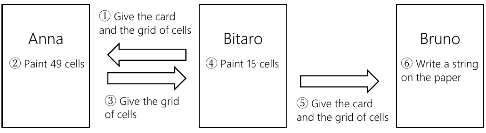

<blockquote markdown="1">
**Submission on AtCoder**

[Distributed Files](https://www2.ioi-jp.org/camp/2023/2023-sp-tasks/contest4/battle-dist.zip)

Your program must include `Anna.h` and `Bruno.h`, and implement all functions in one file. Do NOT share global variables.

You can submit only C++ source code.

The two-file organization in Implementation Details and the instructions in Compilation and Test Run below describe local testing with the distributed sample grader. On AtCoder, submit one file as described above.
</blockquote>

Score: $100$ points

### Problem Statement

JOICup is a popular television variety program held by JOI broadcast station. Now JOICup becomes the final round. In the final round, the “messenger game” will be played. Only one team which passed the first round will play the game. The team consists of two players, Anna and Bruno.

In the messenger game, the players send information using a grid of $8 \times 8$ cells. The rows of the grid are numbered from $0$ to $7$, and the columns of the grid are numbered from $0$ to $7$.

In the messenger game, Anna and Bruno are isolated in different rooms. They will play $Q$ challenges. The $i$-th challenge ($1 \leq i \leq Q$) proceeds as follows.

1. Bitaro, the moderator of the game, gives a card and a grid of $8 \times 8$ cells to Anna. On the card, three integers $X_i, Y_i, N_i$ ($0 \leq X_i \leq 7$, $0 \leq Y_i \leq 7$, $1 \leq N_i \leq 43$) and a string $S_i$ of length $N_i$ consisting of `A` and `B` are written. All of the cells in the grid are white.
2. Anna paints each of the $49$ cells whose row is different from $X_i$ and column is different from $Y_i$. The color of each cell is either blue or red.
3. Anna gives the grid of cells to Bitaro, the moderator of the game.
4. Bitaro paints each of the $15$ cells whose row is equal to $X_i$ or column is equal to $Y_i$. The color of each cell is either blue or red. This process is done in a room which is not seen by Anna nor Bruno.
5. Bitaro, the moderator of the game, gives a card and the grid of cells to Bruno. Only the integer $N_i$ is written on the card.
6. Bruno writes a string on a paper. If it coincides with $S_i$, Anna and Bruno win the game.

The challenges proceed as in the following figure.

Write programs which implement the strategies of Anna and Bruno to win the “messenger game.” For the grading of this task, see Grading.

---

### Implementation Details

You need to submit two files.

The first file is `Anna.cpp`. It should implement Anna's strategy. It should implement the following functions. The program should include `Anna.h` using the preprocessing directive `#include`.

- `void Anna(int X, int Y, int N, std::string S)`

    This function is called $Q$ times. The $i$-th call ($1 \leq i \leq Q$) corresponds to the procedures $1.$, $2.$, $3.$ of the $i$-th challenge of the game.

    - The parameter `X` is the integer $X_i$ written on the card given to Anna in the procedure $1.$ of the $i$-th challenge.
    - The parameter `Y` is the integer $Y_i$ written on the card given to Anna in the procedure $1.$ of the $i$-th challenge.
    - The parameter `N` is the integer $N_i$ written on the card given to Anna in the procedure $1.$ of the $i$-th challenge.
    - The parameter `S` is the string $S_i$ written on the card given to Anna in the procedure $1.$ of the $i$-th challenge.

    For each function call to `Anna`, the following function should be called $49$ times in total. The following function should be called once for each of the $49$ cells whose row is different from $X_i$ and column is different from $Y_i$.

    - `void Paint(int a, int b, int c)`

        - The parameters `a, b` mean Anna paints the cell whose row is $a$ and column is $b$. Here the conditions $0 \leq a \leq 7$, $0 \leq b \leq 7$, $a \neq X$, $b \neq Y$ should be satisfied. If this condition is not satisfied, your program is judged as Wrong Answer [1].
        - The parameter `c` means the color painted by Anna is blue if $c = 0$, and red if $c = 1$. Here, $0 \leq c \leq 1$ should be satisfied. If this condition is not satisfied, your program is judged as Wrong Answer [2].
        - If the function `Paint` is called with the same parameters $(a, b)$ more than once, your program is judged as Wrong Answer [3].
        - When the function `Anna` terminates, if the number of function calls to `Paint` is different from $49$, your program is judged as Wrong Answer [4].

The second file is `Bruno.cpp`. It should implement Bruno's strategy. It should implement the following function. The program should include `Bruno.h` using the preprocessing directive `#include`.

- `std::string Bruno(int N, std::vector<std::vector<int>> T)`

    This function is called every time when Anna finishes painting the grid. This function is called $Q$ times in total. The $i$-th call ($1 \leq i \leq Q$) corresponds to the procedures $5.$, $6.$ of the $i$-th challenge of the game.

    - The parameter `N` is the integer $N_i$ written on the card given to Bruno in the procedure $5.$ of the $i$-th challenge.
    - The parameter `T` is a two-dimensional array of size $8 \times 8$ corresponding to the grid of cells given to Bruno in the procedure $5.$ of the $i$-th challenge. The color of the cell whose row is $a$ ($0 \leq a \leq 7$) and column is $b$ ($0 \leq b \leq 7$) is blue if `T[a][b] = 0`, and red if `T[a][b] = 1`.
    - The return value is the string written by Bruno on a paper.
    - If the return value is a string of length $44$ or more, your program is judged as Wrong Answer [5].
    - Each character of the return value should be either `A` or `B`. If this condition is not satisfied, your program is judged as Wrong Answer [6].

### Important Notices

- Your program can implement other functions for internal use, or use global variables. Submitted files will be compiled with the grader, and become a single executable file. All global variables and internal functions should be declared in an unnamed namespace to avoid confliction with other files. When it is graded, it will be executed as two processes of Anna and Bruno. The process of Anna and the process of Bruno cannot share global variables.
- Your program must not use the standard input and the standard output. Your program must not communicate with other files by any methods. However, your program may output debugging information to the standard error.

### Compilation and Test Run

You can download an archive file from the contest webpage which contains the sample grader to test your program. The archive file also contains a sample source file of your program.

The sample grader is the file `grader.cpp`. In order to test your program, put `grader.cpp`, `Anna.cpp`, `Bruno.cpp`, `Anna.h`, `Bruno.h` in the same directory, and run the following command to compile your programs. Instead, you may run `compile.sh` contained in the archive file.

~~~
g++ -std=gnu++17 -O2 -o grader grader.cpp Anna.cpp Bruno.cpp
~~~

When the compilation succeeds, the executable file `grader` is generated.

Note that the actual grader is different from the sample grader. In particular, Bitaro does not necessarily choose the colors to paint the cells randomly. The sample grader will be executed as a single process, which will read input data from the standard input and write the results to the standard output.

### Input for the Sample Grader

The sample grader reads the following data from the standard input.

~~~
$Q$
$X_1$ $Y_1$ $N_1$ $S_1$
$X_2$ $Y_2$ $N_2$ $S_2$
$\vdots$
$X_Q$ $Y_Q$ $N_Q$ $S_Q$
~~~

### Output of the Sample Grader

The sample grader outputs the following information to the standard output (quotes for clarity).

- If your program is judged as correct, it writes the value of $L^{\ast}$ as `Accepted: 28`. For the value of $L^{\ast}$, see Grading.
- If your program is judged as any type of Wrong Answer, the sample grader writes its type as `Wrong Answer [1]`.

If your program satisfies the conditions of several types of Wrong Answer, the sample grader reports only one of them.

In the sample grader, the colors chosen by Bitaro for challenges are randomly determined by pseudorandom numbers whose results do not change for different executions. In order to change the seed of pseudorandom numbers, run the sample grader with the first integer argument as follows.

~~~
./grader 2023
~~~

---

### Constraints

- $1 \leq Q \leq 20\,000$.
- $0 \leq X_i \leq 7$ ($1 \leq i \leq Q$).
- $0 \leq Y_i \leq 7$ ($1 \leq i \leq Q$).
- $1 \leq N_i \leq 43$ ($1 \leq i \leq Q$).
- $Q, X_i, Y_i, N_i$ are integers.
- $S_i$ ($1 \leq i \leq Q$) is a string of length $N_i$ consisting of `A` and `B`.

### Grading

If your program is judged as any type of Wrong Answer [1]–[6] (see Implementation Details) or any type of runtime errors (TLE (Time Limit Exceeded), MLE (Memory Limit Exceeded), Abnormal End, etc.) in any of the test cases, your score is $0$ point regardless of whether your program wins challenges in other test cases.

Otherwise, let $L^{\ast}$ be the minimum of the following values for all test cases of this task. Your score is calculated as in the following table.

- The maximum value of $L$ such that Anna and Bruno win all the challenges satisfying $N_i \leq L$. However, if they win all the challenges in the test cases, we set $L = 43$.

| $L^{\ast}$ | $0$ | $1$ | $2$ | $3$ | $4$ | $5$ | $6$ | $7$ | $8$ | $9$ | $10$ | $11$ | $12$ | $13$ | $14$ |
| --- | --- | --- | --- | --- | --- | --- | --- | --- | --- | --- | --- | --- | --- | --- | --- |
| Score | $0$ | $5$ | $8$ | $10$ | $11$ | $13$ | $14$ | $16$ | $18$ | $19$ | $21$ | $22$ | $24$ | $26$ | $27$ |

| $L^{\ast}$ | $15$ | $16$ | $17$ | $18$ | $19$ | $20$ | $21$ | $22$ | $23$ | $24$ | $25$ | $26$ | $27$ | $28$ | $29$ |
| --- | --- | --- | --- | --- | --- | --- | --- | --- | --- | --- | --- | --- | --- | --- | --- |
| Score | $29$ | $30$ | $32$ | $34$ | $35$ | $37$ | $38$ | $40$ | $42$ | $43$ | $45$ | $46$ | $48$ | $50$ | $51$ |

| $L^{\ast}$ | $30$ | $31$ | $32$ | $33$ | $34$ | $35$ | $36$ | $37$ | $38$ | $39$ | $40$ | $41$ | $42$ | $43$ |
| --- | --- | --- | --- | --- | --- | --- | --- | --- | --- | --- | --- | --- | --- | --- |
| Score | $53$ | $54$ | $56$ | $57$ | $59$ | $60$ | $62$ | $65$ | $68$ | $71$ | $74$ | $77$ | $84$ | $100$ |

---

### Sample Communication

Here is a sample input for the sample grader and corresponding function calls. The parameters `T` for the function calls to `Bruno` are omitted.

### Sample Input 1

~~~
2
0 0 1 B
5 7 8 AAAABBBB
~~~

#### Sample Function Calls

| Function call to Anna | Function call to Bruno | Return value of Bruno |
| --- | --- | --- |
| `Anna(0, 0, 1, "B")` | | |
| `Paint(1, 1, 0)` | | |
| `Paint(1, 2, 1)` | | |
| $\ldots$ | | |
| `Paint(7, 7, 1)` | | |
| | `Bruno(1, ...)` | `"B"` |
| `Anna(5, 7, 8, "AAAABBBB")` | | |
| `Paint(0, 0, 1)` | | |
| `Paint(0, 1, 1)` | | |
| $\ldots$ | | |
| `Paint(7, 6, 0)` | | |
| | `Bruno(8, ...)` | `"AAAABBBB"` |

In this sample input, there are $Q$ ($= 2$) challenges.

- In the first challenge, we have $X_1 = 0$, $Y_1 = 0$, $N_1 = 1$, $S_1 =$ `"B"`. Anna paints the $49$ cells whose row is different from $0$ and column is different from $0$.
- In the second challenge, we have $X_2 = 5$, $Y_2 = 7$, $N_2 = 8$, $S_2 =$ `"AAAABBBB"`. Anna paints the $49$ cells whose row is different from $5$ and column is different from $7$.

For example, if your program calls `Paint(0, 2, 1)` in the first challenge, it is judged as Wrong Answer [1] because it designates a cell whose row is $0$.

Here is another sample input for the sample grader.

### Sample Input 2

~~~
30
3 1 1 A
1 4 1 A
6 6 2 AA
1 1 2 BB
3 1 3 BAB
7 4 3 AAB
6 4 4 BAAB
6 7 4 BABA
3 3 5 BABBA
1 5 5 ABBBA
4 3 6 ABBBBB
2 1 6 ABAAAA
6 0 7 AAABABA
6 6 7 BBABBAA
0 4 8 AABAABAB
2 1 8 AABBBBBA
2 0 9 BABABBAAA
1 5 9 BBAAABABB
6 7 10 BAAABAAABB
1 7 10 BBBBBBBABA
2 6 12 AABAABABABAB
3 4 15 BBAABAAAABABAAB
5 6 18 BAAAABBABABBBABBAB
7 0 22 BABBAABAAABBABBBBBBABA
2 0 26 AAAABBABBAAAAABABABBAABAAA
0 7 30 AAABBBAAABAABBBBAABBAAABBBABBB
2 7 34 BABAABBAABABBABAABBABBABAABBBBABBB
2 5 38 BBBBAABAABAABABABBBBBAAABBABAAABAAABBB
5 2 41 AABABBAAABBABAAAABBABABBAAAAAABBABBABBABA
1 0 43 AABBABBBBABABBBABBBBAAAAAABABAAABBBAABBAAAB
~~~
